# Stadion Utama Riau — Simulator 3D

Simulator 3D interaktif kawasan **Stadion Utama Riau** (Jl. Naga Sakti, Panam, Pekanbaru) dibangun dengan [Three.js](https://threejs.org) 0.186 + Vite. Hampir semua geometri prosedural; dua model Blender (GLB: tugu Lancang Kuning dan bangku taman) dimuat dari `public/models/`. Font Inter/JetBrains Mono di-host sendiri (`@fontsource-variable`), jadi tidak butuh internet.

| Interior tribun | Plaza & gate utara |
|---|---|
| 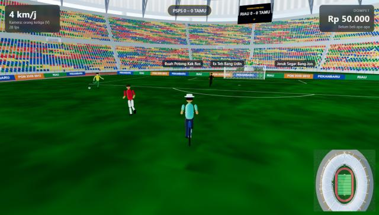 | 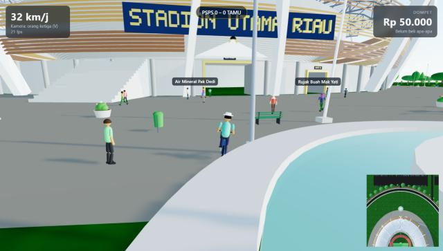 |
| **Gapura Jl. Naga Sakti** | **Tugu Lancang Kuning** |
| 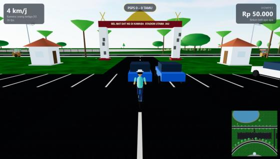 | 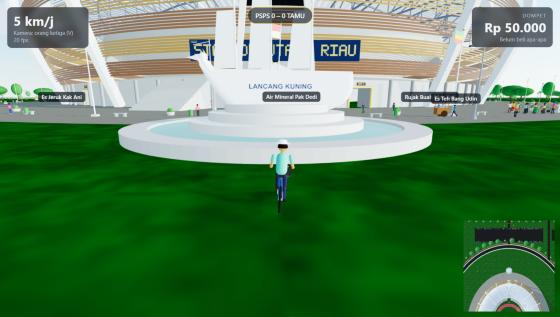 |
| **Gaya stylized siang** | **Malam, PJU menyala** |
| 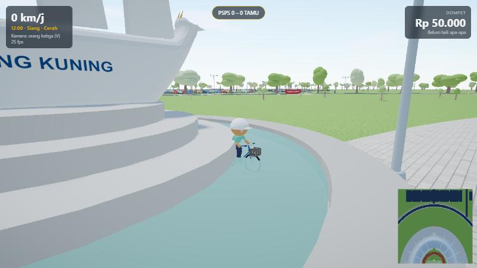 | 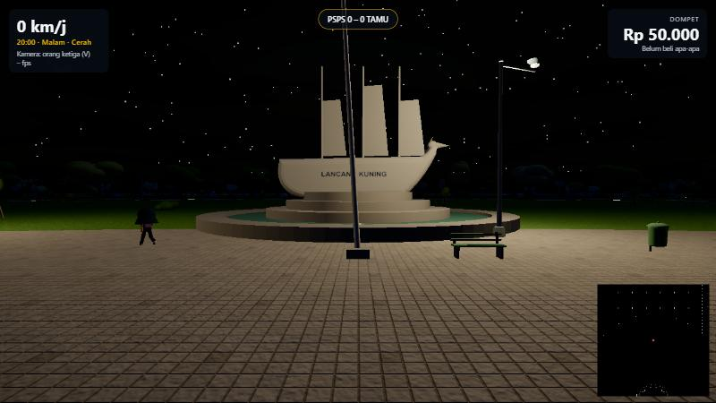 |
| **Tribun siang** | **Malam hujan** |
| 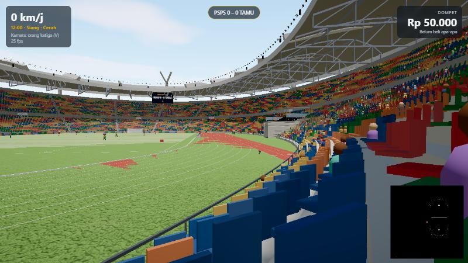 | 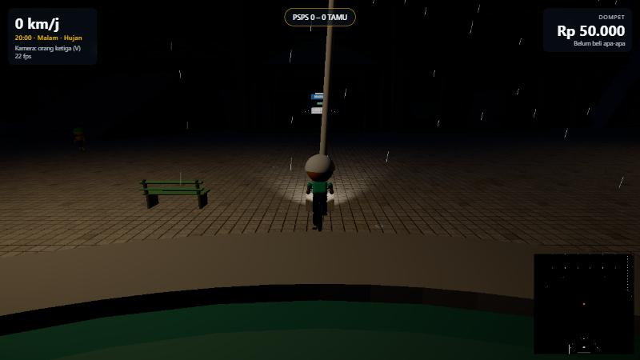 |

## Fitur
- **Bersepeda** keliling kawasan dan masuk ke dalam stadion lewat gate utama utara/barat (model kinematik sepeda: inersia, lean saat belok, roda & pedal berputar, bel).
- **Pedagang keliling** minuman (es teh, es jeruk, air mineral, kopi) dan buah (buah potong, jeruk, rujak) dengan gerobak PKL; dekati lalu tekan **E** untuk membeli dengan dompet Rp 50.000.
- **Pertandingan sepak bola NPC** 5 vs 5 dengan bola fisika ringan, skor di videotron dan HUD.
- **Pelari di tiap lane** lintasan atletik 400 m (8 lane) plus pejalan/pelari di jalan lingkar dan jogging track.
- **Siklus waktu & cuaca**: matahari bergerak, langit/kabut berubah, malam dengan PJU, floodlight, lampu depan sepeda, bintang; hujan dengan partikel, cipratan, permukaan basah dan genangan reflektif.
- **Gaya cozy stylized**: karakter chibi (12 gaya rambut, wajah, outfit), vegetasi gumpalan, props membulat, palet pastel, bayangan lembut, tekstur prosedural (aspal, paving, beton, rumput, tartan, metal, kayu).
- **Sudut pandang (POV)** dengan transisi halus yang melewati atas atap: Udara, Tribun, Bola, Pelari (tekan lagi untuk pelari berikutnya), Pedagang, Orbit sinematik, dan Top-down. Di semua POV sepeda dibekukan, kecuali Top-down yang tetap bisa dikendalikan. Reload selalu mulai dari sepeda.
- **Cerita & misi** "Wisata Kuliner dan Budaya Riau": 6 chapter (antar Es Teh ke Pak Satpam, antar Rujak ke Coach Dedi, 3 putaran lintasan, jejak Air Molek, dan chapter kampus "Kampus Biru Langit") dengan hadiah, lencana, gelar, dan 11 easter egg tersembunyi. Tombol **J** membuka jurnal; progres tersimpan di browser (pemain yang sudah tamat langsung mendapat chapter baru).
- **Panel pengaturan** (tombol **H**) gaya kaca gelap: tab Langit (busur matahari interaktif, azimut, jam berjalan, awan, kabut, exposure), Cuaca (hujan, intensitas, basah, angin, suara), Grafik (bayangan, resolusi, AO, vignette, kepadatan penonton), Kamera, Audio, Performa (FPS, draw call live). Semua nilai tersimpan otomatis (localStorage), bisa reset per kontrol/section/semua, tombol screenshot PNG, mode foto (**P**), bantuan (**F1**).
- **Kontrol sentuh & gamepad**: joystick virtual, tombol Bel / E / Lari / Kamera / Jurnal, geser layar untuk melihat (ponsel/tablet); gamepad standar (stick, trigger, tombol aksi). Minimap otomatis dimatikan di ponsel agar tidak menutupi tombol.
- **Performa**: LOD humanoid (mesh gabungan satu draw call di jarak menengah), bayangan dirender tiap 2 frame, **resolusi adaptif** (menurunkan resolusi hanya bila terbukti membantu), minimap 2D (peta dasar di-bake sekali, tanpa render 3D per frame), dunia statis dibekukan (matriks tidak dihitung ulang tiap frame), chunk `three` terpisah di bundel produksi.
- **Lingkungan detail** berbasis riset: rib putih miring + selembayung, atap Kalzip bergelombang, louvre coklat-emas, 12 gate, tribun 2 tier ±39.000 kursi "pixel" warna-warni (sebagian hilang di tribun utara), lapangan FIFA 105×68, lintasan merah bata, floodlight di lingkar atap, patung serindit, tunnel pemain, plaza paving, tiang bendera, bangku, tong sampah, PJU, pot bunga, pos jaga, pagar, gapura "Selamat Datang", tugu Lancang Kuning + kolam, tugu tanjak, parkir mobil/motor, Jl. Naga Sakti dengan lapak PKL (gerobak, tenda ceper, jagung bakar), danau, sungai + jembatan besi, venue baseball, helipad, amphitheater, lintasan sepatu roda, ±1.000 pohon termasuk pohon muda berajir.

## Kontrol
| Tombol | Aksi |
|---|---|
| W / S | kayuh / rem & mundur |
| A / D | belok kiri / kanan |
| Shift | sprint |
| Space | bel |
| Mouse | lihat sekeliling (klik kanvas untuk pointer lock) |
| E | bicara dengan NPC / lanjut dialog / beli dari pedagang (saat prompt muncul) / tutup toko |
| Esc | tutup jurnal / toko |
| V | ganti kamera orang pertama / ketiga (di POV: keluar dari POV) |
| 1 – 7 | sudut pandang (POV): Udara, Tribun, Bola, Pelari, Pedagang, Orbit sinematik, Top-down |
| 0 | keluar dari POV, kembali ke sepeda |
| mouse / roda | orbit dan zoom saat POV aktif |
| J | jurnal cerita (chapter, lencana, easter egg, mulai ulang) |
| M | tampilkan / sembunyikan minimap |
| N | ganti waktu: siang / sore / magrib / malam |
| T | jalankan / hentikan jam (0,25 jam per detik) |
| [ / ] | mundur / maju 1 jam |
| R | hujan / cerah (jalan basah, genangan, kabut) |
| O | ambient occlusion on/off |
| H | buka/tutup panel pengaturan |
| F1 | bantuan kontrol |
| P | mode foto (sembunyikan UI) |

Kombinasi dengan Ctrl/Alt/Meta (mis. Ctrl+R) diabaikan game, dan mengetik di panel pengaturan tidak menggerakkan sepeda.

**Ponsel/tablet:** joystick kiri bawah = kayuh/belok, geser di layar = lihat sekeliling, tombol kanan = Bel, E (interaksi), Lari, Kamera, Jurnal. Panel pengaturan lewat ikon di tepi kanan.

**Gamepad (layout standar):** stick kiri / D-pad = kayuh & belok, stick kanan = lihat, RT/RB = lari, LT = rem, A = bel, X = interaksi (E), Y = kamera, B = Esc, Start = jurnal, Back = panel.

## Kampus UNRI Bina Widya
Kawasan Kampus Universitas Riau Bina Widya (poligon OSM `way/938374562`) di barat daya stadion: terrain dari elevasi SRTM
(relief asli), ±220 gedung OSM dirakit dari kit arketipe, zona handmade **Lembaga** (Sekretariat Lembaga Mahasiswa, Stadion
Mini, Student Center, Rusunawa, FH Panam) dan **Rektorat** (Rektorat + bundaran, Danau Buatan, perpustakaan lama), serta
Masjid Arfa'unnas, Gerbang SM Amin, dan Gedung Grand Gasing Millenium.

- **Ke sana:** kayuh ke selatan dari stadion lewat Jl. Stadion Utama, atau tekan **G** → "Kampus UNRI — Sekretariat Lembaga" / "Kampus UNRI — Rektorat".
- **Kehidupan kampus:** mahasiswa (±30% berjas almamater biru langit, banyak yang beransel) berjalan di bahu jalan/selasar dan duduk di bangku diskusi — ramai 07.00–17.00, sedang 17.00–21.00, sepi malam; motor parkir rapat (empat model Blender: bebek, matic, sport, tua; parkir dekat Integrated Classroom penuh siang hari) dengan LOD per instans; satpam di Pos Keamanan Gerbang Binakrida; pedagang nasi kotak di Kantin FKIP.
- **Sekretariat:** tekan **E** di depan pintu sekre untuk masuk; di dalam berjalan kaki, NPC beraktivitas sesuai jam game, ≥ 10 barang bisa dipakai, 4 preset kamera foto.
- **Cerita:** chapter 6 "Kampus Biru Langit" (nasi kotak dari Kantin FKIP, tanda tangan Ketua BEM, keliling Danau Buatan, kipas sekre) dan 3 easter egg kampus (lambang 1-10-62 di plang dekat Gerbang Soebrantas, julukan "Kampus Biru Langit", mengitari GGM).
- **Fakta vs inferensi:** fakta bersumber di `docs/research/kampus-unri-bina-widya.md`; status & keyakinan aset di `docs/superpowers/specs/2026-10-17-unri-asset-catalog.md`; sumber & keyakinan per gedung di `src/districts/unri/buildings.data.js`. Detail yang tidak terkonfirmasi (denah sekre, warna gedung lama, penempatan plang lambang, seragam satpam, bentuk motor) ditandai [INFERENSI]. **Isi interior sekre (struktur pengurus, proker, catatan rapat, dst.) adalah data contoh** di `src/interiors/sekre/data.js` — ganti dengan data organisasi nyata.

### Kontrol di dalam sekre
| Tombol | Aksi |
|---|---|
| W / A / S / D | jalan |
| Shift | lari |
| Mouse | lihat sekeliling |
| E | pakai barang (gitar, kipas, dispenser, saklar, papan, …) / tutup kartu info |
| V | orang pertama / orang ketiga |
| P | mode foto: preset 1–4 (lesehan, pintu, pojok, atas) + kamera bebas (Q/E naik/turun) |
| Esc | keluar sekre |

| Mahasiswa di bahu jalan | Mahasiswa duduk di bangku diskusi |
|---|---|
| 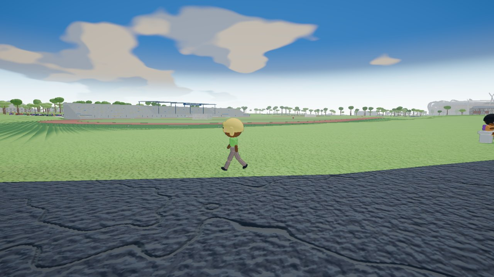 | 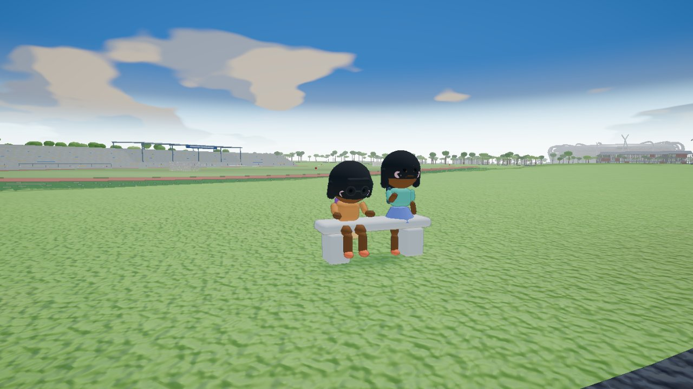 |
| **Motor di teras sekre (model detail)** | **Parkir Integrated Classroom (siang)** |
| 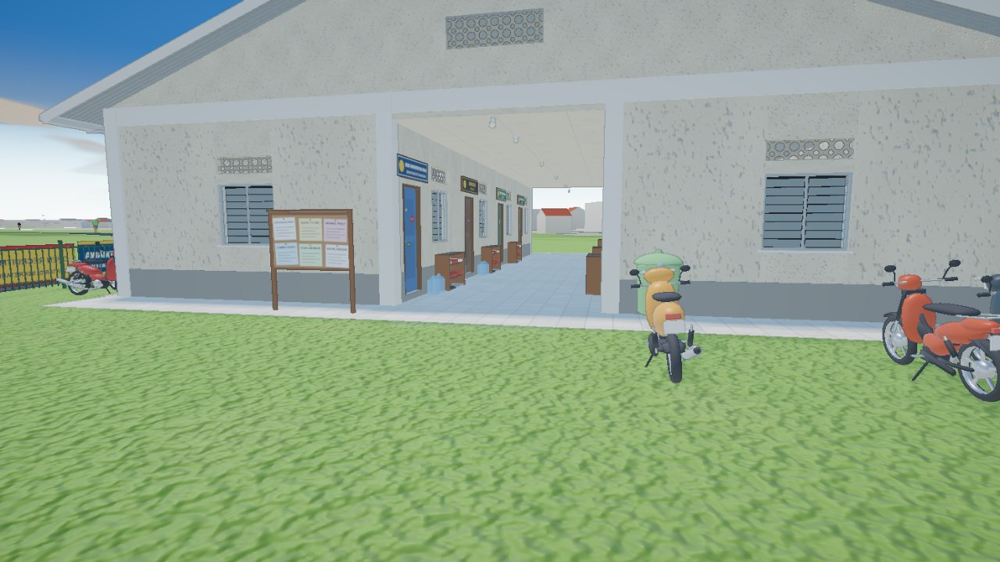 | 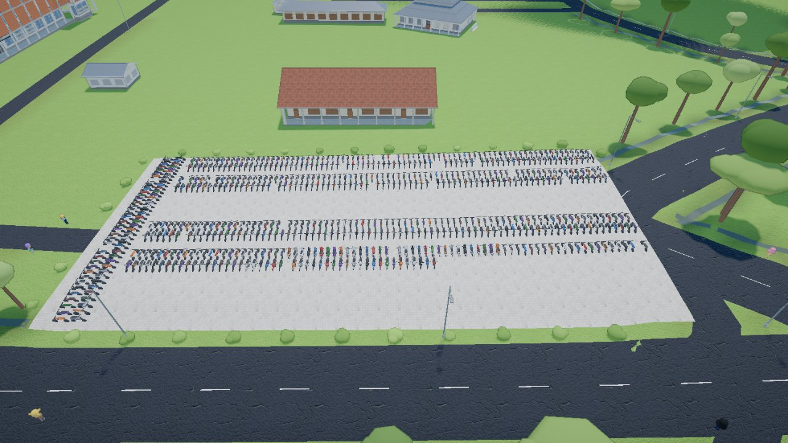 |
| **Lot Stadion Mini (LOD per sel)** | **Kantin FKIP (nasi kotak)** |
| 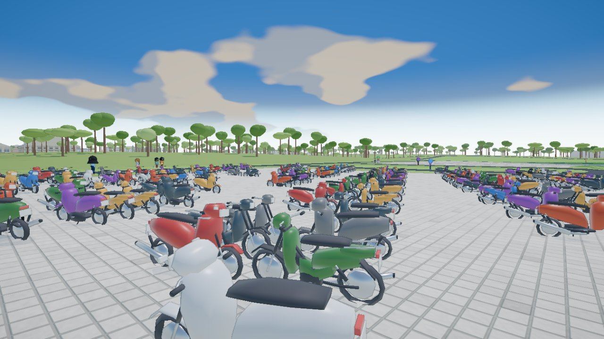 | 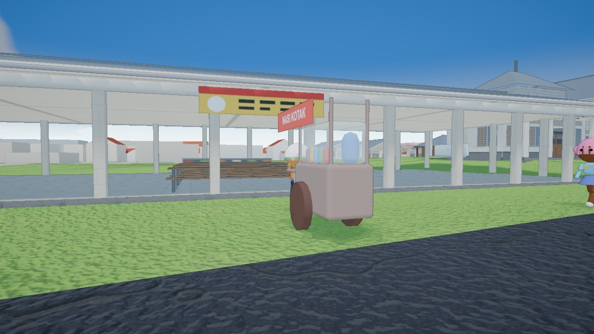 |
| **Satpam Pos Binakrida** | **Plang lambang dekat Gerbang Soebrantas** |
| 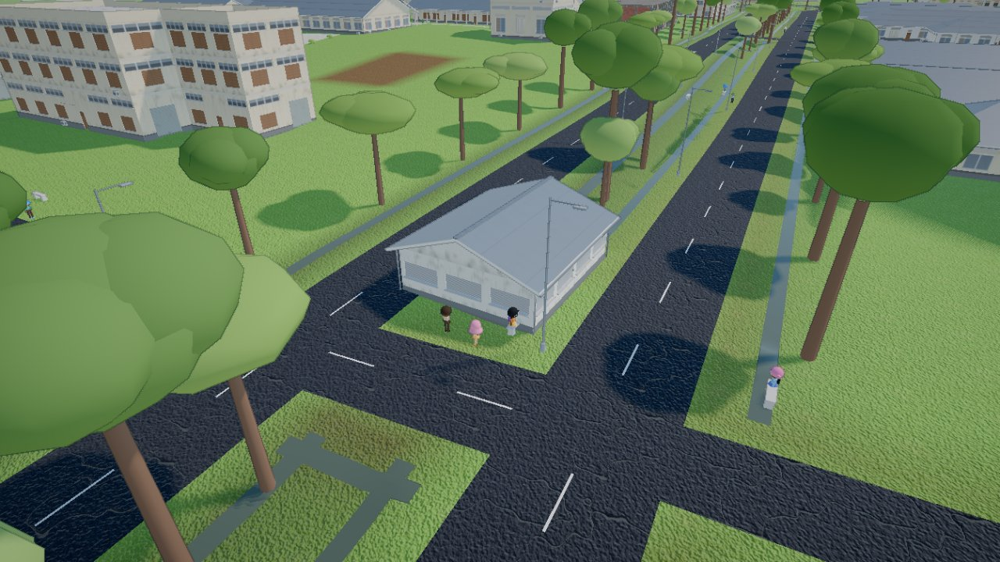 | 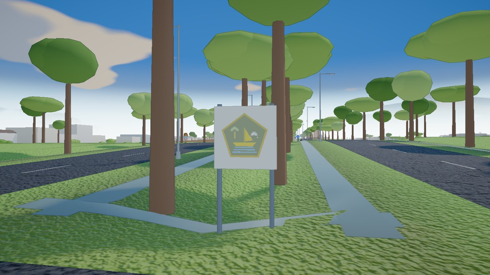 |
| **Sekre malam** | **Perjalanan cepat ke Sekretariat** |
| 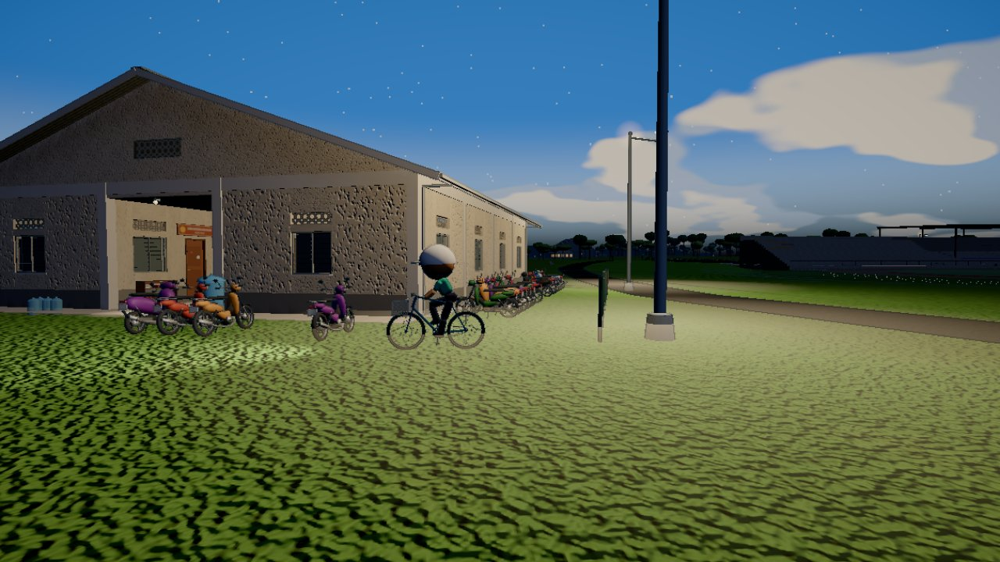 | 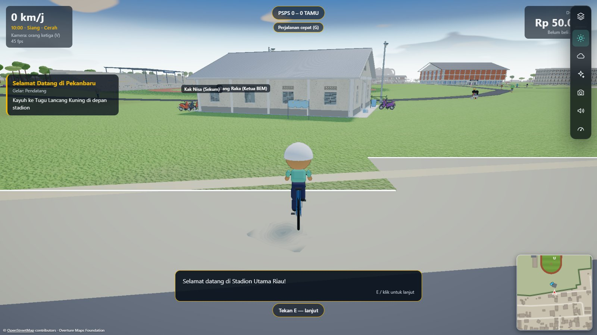 |

## Menjalankan
```bash
npm install
npm run dev
```
Buka `http://localhost:5173` di Chrome/Edge desktop.

Build produksi: `npm run build` (hasil di `dist/`). Deploy otomatis ke GitHub Pages lewat GitHub Actions saat push ke `main`.

## Test
```bash
npm test
```
Unit test (Vitest) mencakup logika murni di `src/sim/` (fisika sepeda/bola, AI sepak bola, pelari, pedagang, siklus hari), mesin cerita (`reducer`, objective, pemicu easter egg, penyimpanan), pengaturan (skema, store, binding), kontrol (Input, gamepad, joystick sentuh, matematika minimap, kontroler resolusi adaptif), serta LOD humanoid, chunking instansi, dan komponen UI via jsdom.

## Struktur
```
src/
  app/         composition helper: mountRegion, frame region, perjalanan cepat, keymap, devtools
  districts/   distrik (defineDistrict) + Kampus UNRI: terrain, tanah, kit gedung, kehidupan kampus
  interiors/   interior (defineInterior) + sekre
  engine/      SystemRunner, ResourceScope, disposeTree, freezeStatic, registry material
  geo/         proyeksi ENU, grid tile, transform & placement region, poligon (murni)
  regions/     region handmade (stadion: data, layout, mask, collider, footprint OSM)
  city/        klien streaming tile kota: ChunkStreamer, TileLoader, TileCollider, minimap tile
  core/        App (renderer, loop, post-processing, bake minimap), Input, gamepad, CameraRig,
               Collider komposit, StoryDirector, adaptiveResolution, AudioBus
  config/      constants.js + stadionSite.js — dimensi, warna, data kawasan
  sim/         logika murni tanpa THREE.Mesh (unit-tested); sim/story = mesin cerita
  story/       data cerita (chapter, easter egg), pemicu, penyimpanan, pengaman uang
  settings/    skema, store, safeStorage (localStorage)
  world/       builder geometri statis: Ground, Landscape, stadium/*, props/*, langit/cuaca
  entities/    objek bergerak: Bicycle, Runner, Footballer, Vendor, Crowd, Humanoid (+ LOD)
  ui/          HUD, panel pengaturan, TouchControls, Minimap2D, perjalanan cepat, atribusi
tools/citybake/ bake offline OSM + Overture → public/tiles (Node; tidak ikut bundle)
tools/campusbake/ bake offline kampus (DEM SRTM + OSM) → public/districts/unri
tools/shots/   alat screenshot/ukur Playwright GPU (kampus: m7Visual, m7Travel, m7Eggs, m7Story, m7Profile)
public/tiles/  tile kota hasil bake (GLB meshopt + data.json + manifest + ATTRIBUTION.txt)
public/models/ model Blender (GLB)
assets-src/    sumber .blend + skrip ekspor (export_glb.py)
docs/
  research/    riset fakta stadion & teknis Three.js
  superpowers/ spec desain, rencana implementasi, audit & roadmap perbaikan
```

Model GLB dihasilkan dari Blender lewat `assets-src/blender/export_glb.py` (alur Blender → GLB → `src/world/assets/models.js`).

## Kredit
Pola UI panel pengaturan diadaptasi dari [dgreenheck/tidewater](https://github.com/dgreenheck/tidewater) (lisensi MIT).

## Tekstur PBR (gaya Kartun / Facet)
Tanah, jalan beton/aspal, paving, dan lantai hutan sekre memakai tekstur PBR nyata dari [ambientCG](https://ambientcg.com) (lisensi **CC0 1.0**, daftar ID di `public/textures/ATTRIBUTION.txt`) hanya pada gaya Kartun/Facet; gaya Asli tetap tekstur prosedural. Alur: `npm run download:tex` (unduh paket 1K-JPG ke `data-src/textures/`, tidak di-commit) lalu `npm run bake:tex` (WebP 512/256 px, 1024 untuk plester/seng/kayu/kulit pohon, ORM dipak R=AO G=Roughness, `manifest.json`). Tanah memakai shader splat 5 lapisan (`src/world/terrain/terrainSplat.js`) dengan tiga tingkat kualitas (pengaturan Grafik > Kualitas tekstur tanah: otomatis/tinggi/sedang/rendah). Galeri dev: `/tekstur-gallery.html` (atau `/?tekstur`).

## Data peta & atribusi
Jalan, bangunan, air, dan tata guna lahan kota berasal dari © [OpenStreetMap](https://www.openstreetmap.org/copyright) contributors dan Overture Maps Foundation, di-bake offline oleh `tools/citybake` (`npm run bake -- --area stadion|pusat|all`; cache data mentah di `data-src/`, tidak di-commit). Data turunan di `public/tiles/` (`*.glb`, `*.data.json`) berlisensi **ODbL 1.0**; rincian sumber, waktu data, dan rilis Overture ada di `public/tiles/ATTRIBUTION.txt`. Atribusi juga tampil di pojok kiri bawah layar selama peta kota aktif.

Kawasan Kampus UNRI Bina Widya (`public/districts/unri/`) di-bake oleh `tools/campusbake` (`npm run bake:campus -- all`) dari © OpenStreetMap contributors (ODbL 1.0) dan elevasi **SRTM 1 Arc-Second Global (NASA/USGS, domain publik)**; rincian di `public/districts/unri/ATTRIBUTION.txt`. Atribusi OSM + SRTM juga tampil di pojok kiri bawah layar.

## Lisensi
Kode: MIT, lihat [LICENSE](LICENSE). Data tile kota (`public/tiles/`): ODbL 1.0 (lihat bagian "Data peta & atribusi"). Data distrik kampus (`public/districts/unri/`): ODbL 1.0 untuk bagian OSM; elevasi SRTM domain publik.

## Sumber riset
Lihat `docs/research/stadion-utama-riau.md` (Dispora Riau, StadiumDB, Wikipedia, liputan media lokal) dan `docs/research/threejs-teknis.md`.
